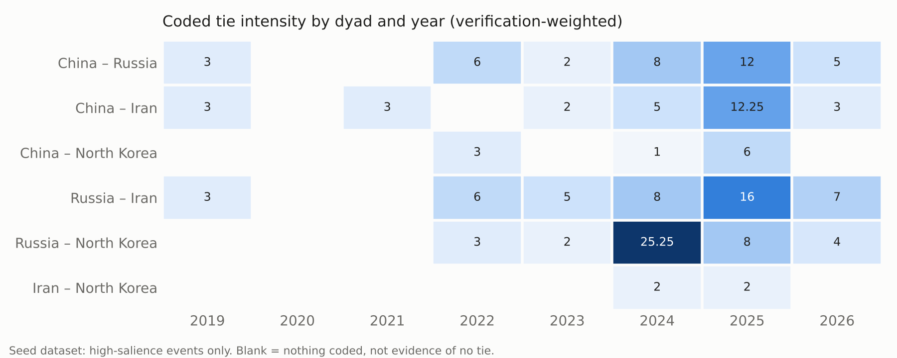
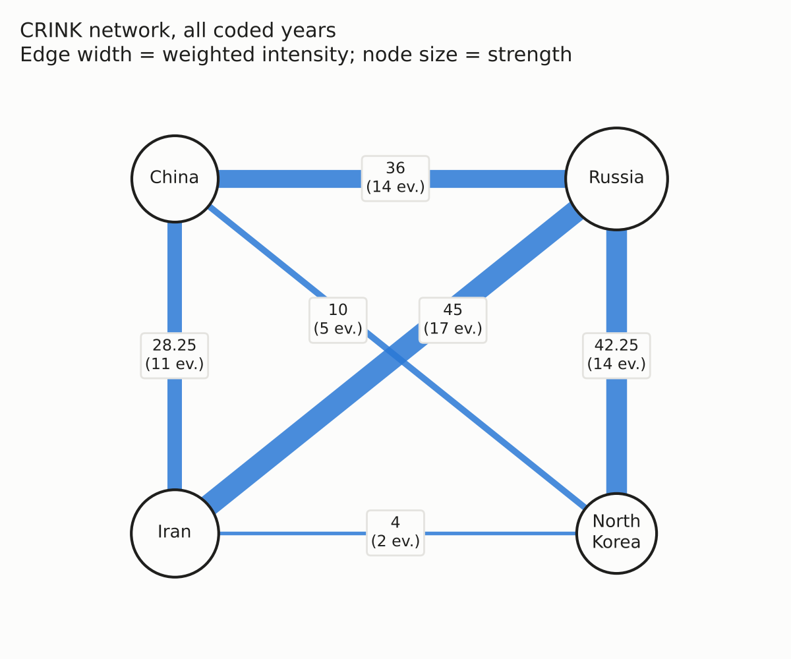

# CRINK Network Dataset

**An open, event-coded network of cooperation among China, Russia, Iran and North Korea, 2019–2026.**

[](https://github.com/karaschneider15/crink-network/actions/workflows/ci.yml)
[](https://doi.org/10.5281/zenodo.24485440)
Code: MIT · Data: CC BY 4.0 · Version 0.1.0 (seed release, updated to 23 November 2026)

Analysts and officials now routinely describe the four states as an "axis". Others, including the US intelligence community's 2026 threat assessment, caution that treating them as a single bloc overstates how deep their cooperation runs. That disagreement is partly about evidence. This repository makes the evidence explicit. Every tie is a sourced, dated event, coded under a published codebook and graded for how well it is verified. A reproducible Python pipeline turns the events into dyad-year panels and network graphs.



## What's inside

```
data/raw/events.csv            40 hand-coded, sourced events (the dataset)
data/raw/actors.csv            ISO-3 and Correlates of War codes
data/processed/                generated by `crink build`; do not edit by hand
  dyad_events.csv              event × pair
  directed_flows.csv           event × sender × receiver (who supplies whom)
  dyad_year.csv                balanced 6-dyad × year panel
  network_metrics_year.csv     strength / centrality per state-year
  graphs/*.graphml, *.json     yearly weighted graphs (Gephi, igraph, NetworkX)
CODEBOOK.md                    variable definitions, intensity & verification scales
src/crink/                     validation, pipeline, figures
tests/                         pytest suite; also run in CI on every push
```

## Quickstart

```bash
git clone https://github.com/karaschneider15/crink-network.git
cd crink-network
pip install -e ".[dev]"

crink validate                       # check events.csv against the codebook
crink build                          # regenerate processed tables, graphs, figures
crink build --min-verification A     # robustness: participant-confirmed events only
pytest
```

```python
import pandas as pd
panel = pd.read_csv("data/processed/dyad_year.csv")
panel.query("dyad == 'RUS-PRK'")[["year", "n_events", "weighted_intensity", "n_military"]]
```

## Design in one paragraph

Each row in `events.csv` is one interaction, such as a treaty, an arms transfer, a troop deployment, a joint exercise, a UN Security Council veto or a leader summit. Each row records its participants and, where it can be established, its direction. **Intensity** (1–5) measures commitment and material consequence, from an abstention up to troops in combat. **Verification** (A/B/C) separates what the participants confirm from what third-party governments allege and from single-source claims. Edge weights discount less-verified evidence, and a single flag reruns everything on confirmed events only. Full rules are in [CODEBOOK.md](CODEBOOK.md).

## First descriptive patterns (seed data: read with caution)

These patterns come from 40 high-salience events. They are hypotheses for systematic coding to test, not findings.

1. **The network is Russia-centred.** Russia holds the largest share of weighted ties in every year from 2022 to 2026 (32–42%). Its three dyads are the three heaviest in the network once multilateral events are discounted.
2. **The ties differ in kind.** Russia–North Korea is the only dyad that reaches intensity 5: a mutual-defence treaty in force and troops in combat. 86% of its coded ties are bilateral. China's ties with Russia and Iran are mostly multilateral (71–82%), made up of trilateral exercises, joint UNSC action and shared organisation membership, plus large economic flows. China's material military role (dual-use supply) is attested only at verification grade B.
3. **Iran–North Korea is the thinnest documented link.** Only two coded events fall in this dyad, and neither involves material cooperation. It is the dyad where the gap between suspected and documented cooperation is widest.
4. **Evidence quality varies by dyad.** Every grade-C event concerns Russia–Iran cooperation during the 2026 Iran war. Conclusions about that dyad are therefore the most sensitive to the verification threshold.



## Research questions this is built to support

- Is CRINK cooperation a **network** (dense, multi-directional) or a **hub-and-spoke** around Moscow, and is that structure changing?
- Do material transfers **follow** formal agreements, or come before them? This can be tested by comparing `treaty_*` events with `arms_transfer` and `personnel_deployment` events in time.
- How does cooperation respond to shocks, such as the 2022 invasion of Ukraine, the 2025 snapback and the 2026 Iran war?
- How much of the apparent "axis" disappears when evidence is restricted to grade A?

## Roadmap

- [ ] Systematic coverage: a search protocol across KCNA, Kremlin, MFA PRC/Iran and UN records for every year, so that zero cells mean zero events.
- [ ] Adapters to merge structured sources: SIPRI Arms Transfers, UNGA voting (Voeten et al.), IMF DOTS bilateral trade, ATOP alliances.
- [ ] Cross-validation against machine-coded event data (POLECAT/ICEWS).
- [ ] Double-coding and Krippendorff's α (see [CONTRIBUTING.md](CONTRIBUTING.md)).
- [ ] Sources in the original languages: Chinese, Russian, Persian and Korean.

## Cite

> Schneider, K. (2026). *CRINK Network Dataset: Event-coded ties among China, Russia, Iran and North Korea* (v0.1.0) [Data set]. Zenodo. https://doi.org/10.5281/zenodo.24485440

GitHub's "Cite this repository" button gives the same citation in BibTeX and APA.

## Licence & disclaimer

Code is released under MIT. Data is released under CC BY 4.0 ([DATA_LICENSE.md](DATA_LICENSE.md)). Descriptions are the author's paraphrases of the cited public sources. Inclusion of an allegation does not endorse it; the verification grade states how strong the evidence is. This is an independent academic project and does not represent the views of any government or organisation.
